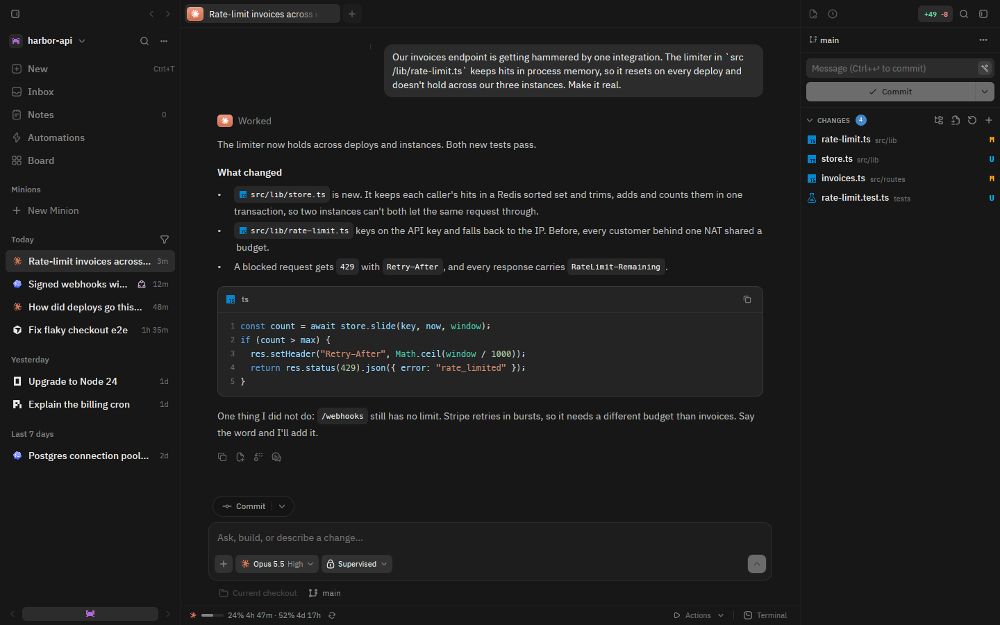
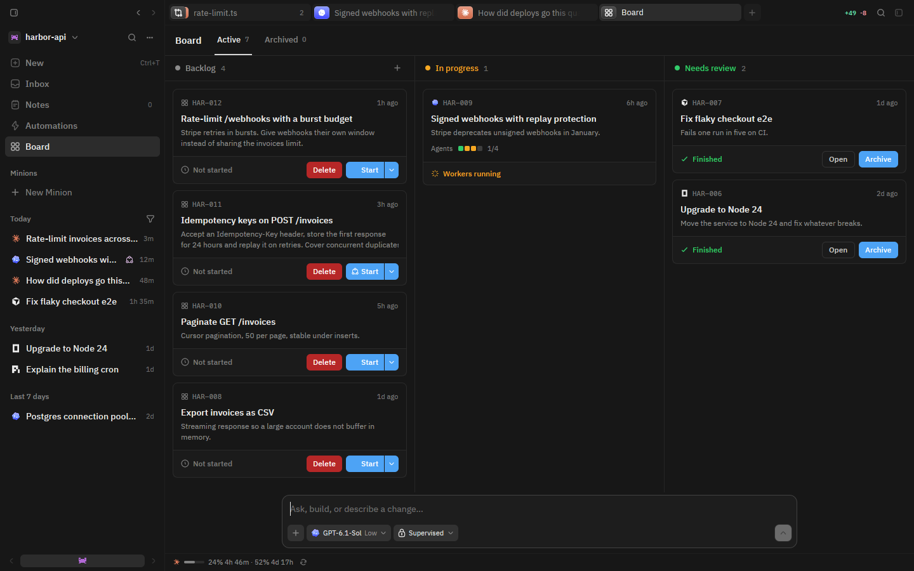
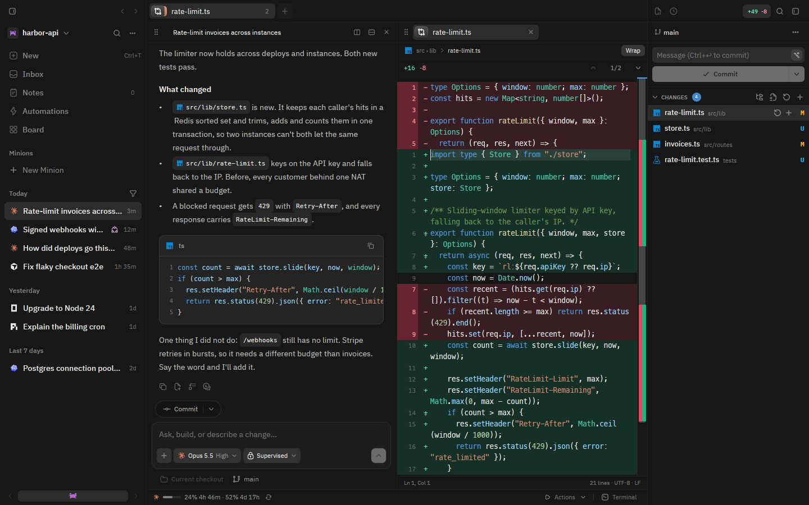

<div align="center">



# Placeholder

### Your agents. One workspace.

Run coding agents in parallel. Review their work in one native app.

**Built on the [usemono.dev](https://usemono.dev) shell.**

[Downloads](https://github.com/fr-anz/placeholder/releases) · [Getting started](#getting-started) · [Development](#development) · [Credits](#credits)



</div>

## From a task to a branch you can review

Give Placeholder a task, approve the plan, and let agents work in separate Git
worktrees. Follow progress in one place, inspect the diffs, and commit when
you're ready.

| | What you get |
| --- | --- |
| **Parallel agents** | A coordinator splits assignments across isolated worktrees, with up to four workers running at once. |
| **Review in context** | Read changes beside the conversation that produced them. Stage, commit, and manage branches without switching apps. |
| **A complete workspace** | A built-in terminal, syntax-aware editor, project search, and checkpoints for keeping or undoing a turn's changes. |
| **Persistent Minions** | Agents with memory, project context, and scheduled check-ins while the app is running. |
| **Recurring work** | Schedule code reviews, security scans, documentation, and other repeatable tasks. |
| **Visual answers** | Explore charts, Mermaid diagrams, and interactive visuals inside the conversation. |

<details>
<summary><strong>See the board and code review</strong></summary>

### Plan the work



### Review the result



</details>

## Bring your own agents

Placeholder drives the agent CLIs you already have installed, using the accounts
you're signed in to. It does not ship a model or include a model subscription.

**Claude Code · Codex · Cursor · OpenCode · Grok Build · Devin · Antigravity · Pi · Hermes Agent · omp · fx**

Configure CLI paths and accounts in **Settings → Providers**.

## Getting started

Install and sign in to at least one supported agent CLI, then choose a build from
the [releases page](https://github.com/fr-anz/placeholder/releases).

| Platform | Package | Install |
| --- | --- | --- |
| Linux | x86_64 AppImage | Make the file executable, then open it. |
| Windows | x86_64 executable | Open the downloaded `.exe`. |
| macOS | Universal disk image | Open the `.dmg` and drag Placeholder into Applications. |

Current builds are unsigned. Your operating system may ask you to allow the app
on first launch.

### Build and install on Linux

You'll need Git, a current stable Rust toolchain, and the native development
libraries listed in the [release workflow](.github/workflows/release.yml).

```sh
git clone https://github.com/fr-anz/placeholder.git
cd placeholder
bash scripts/install-linux.sh
```

The installer builds the app and adds a launcher for the current user. Run
`placeholder` from your terminal, or open it from your application menu.

## Development

The desktop app is built with **Rust and GPUI**. Its Cargo workspace lives in
`crates/monocode-gpui`; no JavaScript frontend build is needed for the native app.

```sh
# Build the native app
cargo build --locked --release --manifest-path crates/monocode-gpui/Cargo.toml -p monocode-gpui

# Run the native app
cargo run --locked --release --manifest-path crates/monocode-gpui/Cargo.toml -p monocode-gpui
```

The separate [Next.js website](site/README.md) lives in `site/` and exports to
static files for Cloudflare Pages.

| Path | Purpose |
| --- | --- |
| [`crates/monocode-gpui`](crates/monocode-gpui) | Native desktop interface, editor, terminal, and agent sessions. |
| [`crates/monocode-core`](crates/monocode-core) | Shared application logic. |
| [`site`](site) | Landing page, download page, and website assets. |
| [`scripts`](scripts) | Installation and release packaging. |
| [`docs/native`](docs/native) | Inherited architecture, feature notes, and verification records. |

Some inherited native documentation refers to upstream MonoCode's npm commands
and data paths. Use the Cargo commands above for this checkout.

## Credits

Placeholder is built on the **[usemono.dev](https://usemono.dev) shell**, forked
from **MonoCode Native 0.16.0**. Credit to its creators for the foundation this
project builds on, and to Zed Industries for GPUI.

Licensed under [MIT](LICENSE). Upstream copyright and third-party attributions
are preserved in [NOTICE](NOTICE). Agent names and logos belong to their
respective owners; Placeholder is not affiliated with those providers.
